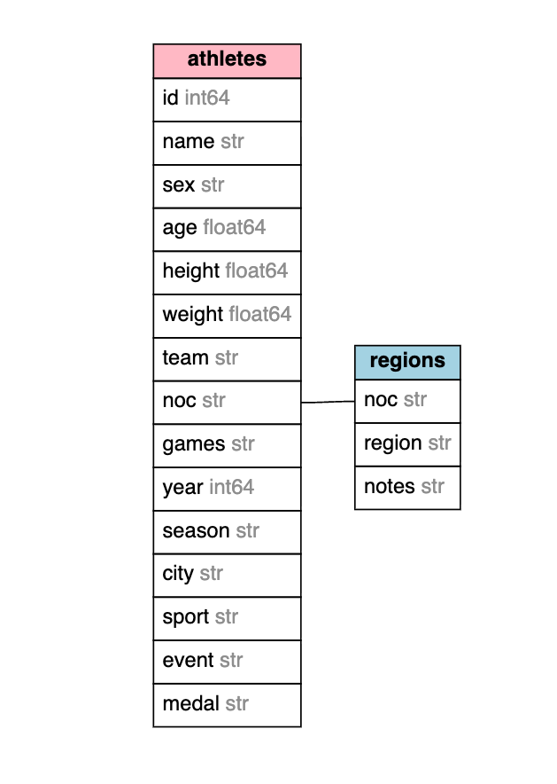
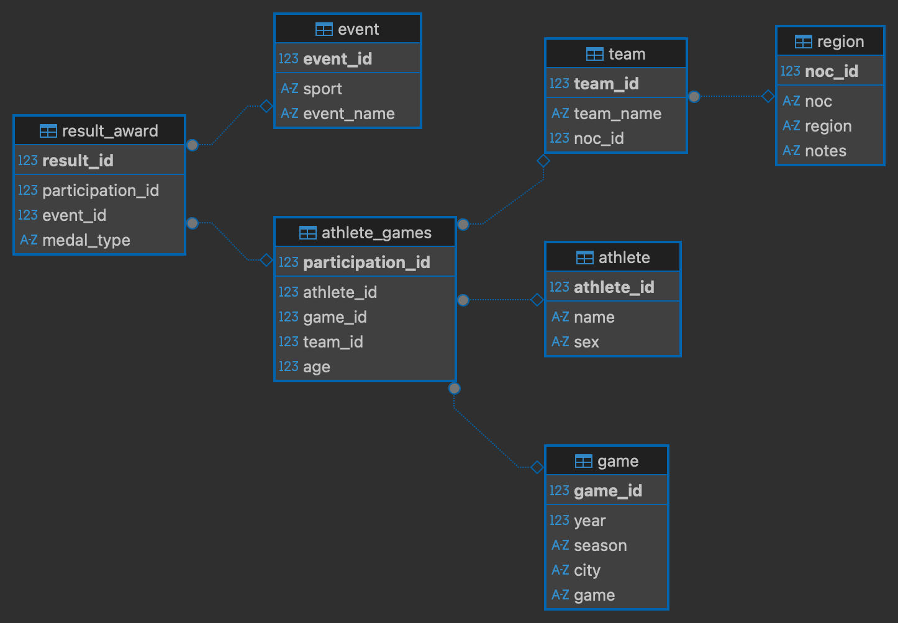

# Assignmnet No. 1
> Coursera | SQL for Data Scientists Capstone Project
[About the course](https://www.coursera.org/learn/sql-data-science-capstone?specialization=learn-sql-basics-data-science)

## Step 1: Preparing for Your Proposal
You will document your preparation in developing the project proposal. This includes:
* Which client/dataset did you select and why?
> Among the three available datasets, I selected `SportStats` files. I think I was fascinated by the idea of working with Olympic Games Data and have 120 years of different records in my disposal. I think I can build an analysis on the records available and it would be beneficial for sports fans or Olympic enthusiasts across the world. Also, this dataset can be enriched by new records -- mainly over time -- and I see a good perspective in developing this project into something bigger. Something that hopefully can showcase my skills.

* Describe the steps you took to import and clean the data.
> For import, I followed the link provided in the [course materials](https://www.dropbox.com/scl/fo/idnc4sbvj9cmefwl51ruy/AFmpaGLav_ZytNbFRs-Iwcw?rlkey=u3y8qw3hsza4jhg3pnqnwcxct&e=1&dl=0). There I could download `.zip` archive (contains a `.csv` file on athletes) and a `.csv` file (contains info on ) to start exploring data.
> To have a quick look on the data, I opened both files using `pandas` library in Python (`pd.read_csv()`). I mainly work for EDA with `.ipynb` formats. What I did:
> * checked the shape of the dataframe (`df.shape`): 271116 rows and 15 columns;
> * took a look at the columns with `df.columns`, also types and null-values with `df.info()`: 
>   * `ID` integer, no null-values; represents a unique identifier of an athlete; can be duplicated (because one athlete can have mltiple entries over years / games and multiple medals); 
>   * `Name` string, no null-values; represents the full name of an athlete; also can be duplicated; 
>   * `Sex` string, no null-values; repsesents the biological sex of an athlete; takes two values -- M for male (195353 entries in the dataset) and F for female (74378 entries in the dataset);
>   * `Age` float, has null-values; represents the age of an athlete at a particular year --> changes from one entry to another even for one athlete; 
>   * `Height` float, has null-values; represents the height of an athlete at a particular year --> changes from one entry to another even for one athlete; 
>   * `Weight` float, has null-values; represents the weight of an athlete at a particular year --> changes from one entry to another even for one athlete; 
>   * `Team` string, no null-values; reprsents the country a particular athlete was a team-member of; can change from year to year; dataset has 1184 unique values for teams;
>   * `NOC` string, no null-values; stands for "National Olympic Committee"; doesn't fully represent the team: there are 230 unique values for NOC; my assumption is that it's also a dynamic measure for an athlete;
>   * `Games` string, no null-values, represents the name of particular Olympic games; the dataset has 51 unique values for games; format is '1992 Summer' or '1998 Winter', so it combines year + season; there are 29 summer games and 22 winter games in the dataset;
>   * `Year` integer, no null-values, represents a year of participation in Olympic games; the dataset has 25 unique years from 1896 to 2016; 
>   * `Season` string, no null-values, can take values "Winter" or "Summer"; 
>   * `City` string, no null-values, represents the location where the games took place; dataset has 42 unique values;, 
>   * `Sport` string, no null-values; represents a sport discipline a particular athlete was performing in; dataset has 66 unique sport disciplines; 
>   * `Event` string, no null-values; represent the type/name of the event the athlete took part in; there are 765 unique events in the dataset; format: "Judo Men's Extra-Lightweight" or "Speed Skating Women's 500 metres"; 
>   * `Medal` string; a lot of null-values (not all participants got awarded); values: "Gold", "Silver" and "Bronze".
> * checked for duplicated values with `sum(df.duplicated())` (1385) and dropped full duplicates with `df.drop_duplicates(inplase=True)`; the amount of rows decreased to 269731 rows;
> * lowercased all column names with `df.columns.str.strip().str.lower()`;

> I also opened the second file provided, it has fewer columns and rows and represents relationships between NOC and region; there are 230 entries for `NOC`, 227 entries for `region` (country or territory), and some `notes` (21 entries); there are no duplicated values in this dataset; 
> I noticed that the file on athletes and events provided for this project is **flat** table, meaning it makes sense to separate it into different tables (e.g., one on athletes, one on events, one on teams, etc). 

> I played around with `pandas` and then wrote a script, creating a PostgeSQL database locally with the following structure (see below under ERD).

* Perform initial exploration of data and provide some screenshots or display some stats of the data you are looking at.
> Some raw numbers I provided above, but here are some more interesting statistics:
> * average age for participating in OG is 23.69 years for women and 26.15 for men; maximum age is 74 (for women) and 97 (for men), minimum 11 (for women) and 10 (for men);
> * five teams with maximum representation of athletes over years are United States (17598 entries), France (11817 entries), Great Britain (11264 entries), Italy (10213 entries), and Germany (9230 entries);
> * average height of a participant is 175 cm (167.84 for women, 178.86 for men); minimum heigh is 127cm (for both sexes) and maximum is 226cm (213cm for women, 226cm for men);
> * average weight of a participant is 70.7kg (60kg for women, 75.7 for men), minimum is 25kg (25kg for women, 28kg for men) and maximum is 214kg (167kg for women, 214kf gor men);
> * summer games historically have more participants (221167 entries) across the years than winter games (48564 entries); summer games also have 52 unique sport disciplines across years, when winter games have only 17; same is fair about events: summer games have 651 unique sport events across years, and winter games only 119.

* Create an ERD or proposed ERD to show the relationships of the data you are exploring. 
> The new ERD looks as following:

#### Step 2: Develop Project Proposal
In this step, you will need to include the following:

**Description**
Write a 5-6 sentence paragraph describing your project; include who might be interested to learn about your findings. Who might be your audience?
> For this project, I selected the **SportStats** dataset, which captures an exhaustive 120-year history of modern Olympic Games records. The project focuses on transforming raw historical records from flat files into a structured, relational PostgreSQL database containing normalized tables for athletes, games, events, and awards. By cleaning the data using Python and structuring it with proper primary and foreign keys, the pipeline ensures data integrity for advanced exploratory analysis. The primary audience for this project includes sports fans, Olympic historians, and data enthusiasts eager to uncover historical trends in athletic performance. Ultimately, this scalable foundation opens up opportunities to continuously enrich the database with new games and performance metrics over time.

**Questions**
* Create 2-3 questions that you want to answer with the data:
> **Q1**: How have participation demographics (such as gender representation and geographic distribution across countries) evolved across summer and winter Olympic games over the 120-year span? 
> **Q2**: Is there a measurable correlation between a country's team representation (linked via NOC codes) and its total medal distribution across specific disciplines over time? 
> **Q3**: How do individual athlete career spans (connecting unique athlete IDs to multiple games and events) correlate with peak medal-winning ages across different sports categories?

**Hypothesis**
* What are your initial hypotheses about the data?
* Write 2-3 assumptions about the data that you'll want to go back to prove or disprove. You will want to keep them in front of you as you look at the data to keep them or change them. You may see relationships that you want to explore and will develop a "belief" about the data.  
> **Assumption 1**: Female participation rates and medal achievements have experienced a sharp upward inflection point in the latter half of the 20th century, particularly following institutional policy changes in international sports federations. 
> **Assumption 2**: Certain countries maintain a persistent specialization advantage in specific event categories (e.g., endurance vs. strength sports) that remains stable across decades regardless of geopolitical shifts. 
> **Assumption 3**: The average peak competitive age for athletes varies systematically by sport discipline, with technical sports showing a slightly higher average age compared to high-impact physical disciplines. 

**Approach**
* Describe in 5-6 sentences what approach you are going to take in order to prove (or disprove) your hypotheses. Think about the following in your answer:  
    * What features (fields/columns) are you going to look at first?
    > I will first look at basic statistics for athletes: total unique participants, participants per year/sex/sport discipline etc; average age for participation per year/sport discipline/sex etc. I would like to see how the demographics of OG was changing over the years.
    > Then I will look at teams: how many teams exist, how many members they have, what is max/min/avg number of teams per year.
    > After that I will explore different sport disciplinces across the years (representation etc) and grouped by seasons.
    > I might try tracking individual trajecroties of those people who participated in OG several times, and I would like to check out some anomalies (e.g., the ounger person is 10 years old? the older is 97?) and outliers.
    * Is there a relationship that exists that you want to explore?
    > I'm tempted to see the relationships between physical characteristics (age, height, weight) and performance, but it's not that interesting to me. I will try to visualize some data first. Plus, I would like to focus on historical analysis and not correlations and factors.
    * What metric/ evaluation measure will you use?
    > I will probably make at least two new fields:
    >   * `year_of_birth` (because currently I only have access to `age`variable, which is dynamic; it can allow for checking "generations" of athletes);
    >   * `change_team` (if an athlete changed team/country, I would like to have this data in thr table).
